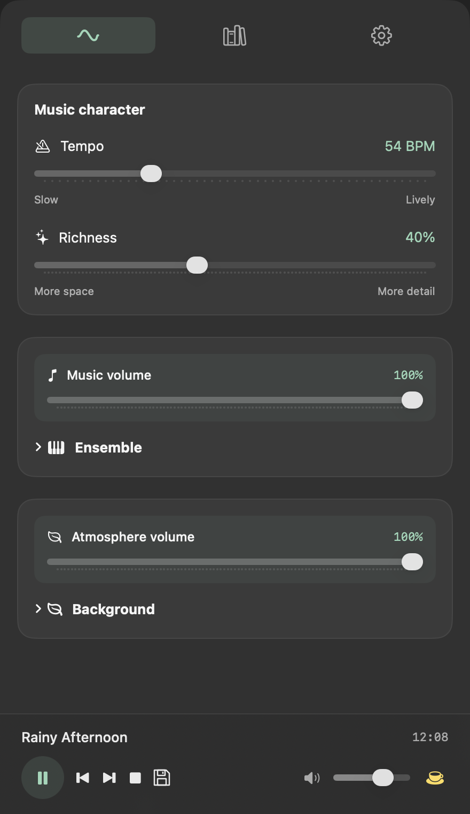
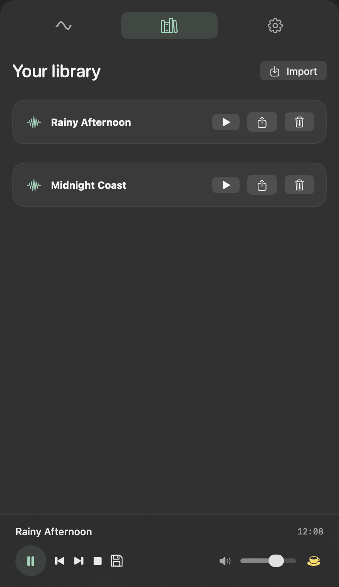
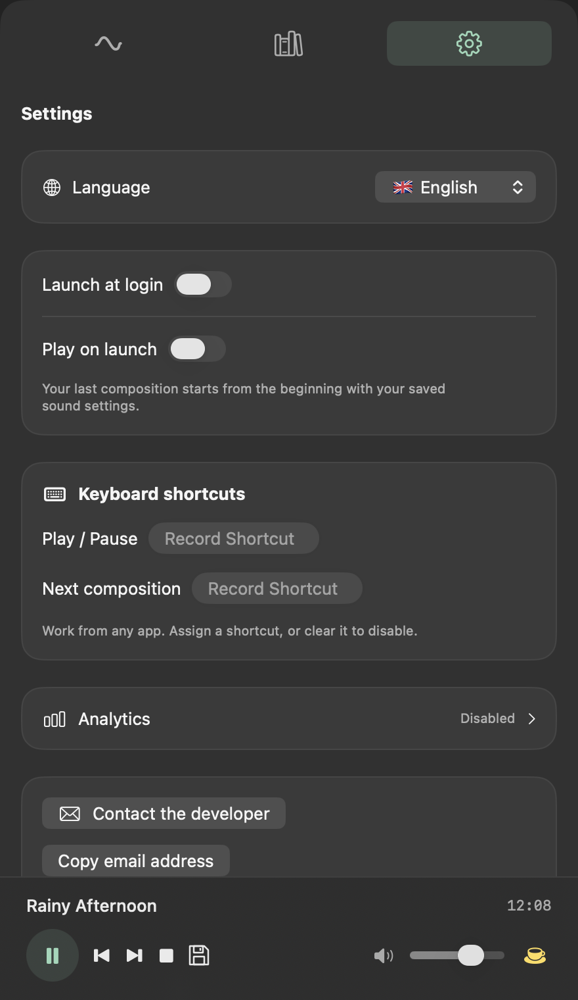

# Undertone

**An endless ambient soundtrack, made on your Mac.**

Undertone lives in your menu bar and creates evolving instrumental music with
natural background sounds. Shape your ensemble, find your balance, and save a
composition to return to later.

[**Download the latest release**](https://github.com/AshamazSh/undertone/releases/latest) ·
[Support development](https://buymeacoffee.com/ashamazsh) ·
[Contact](mailto:ashamaz.shidov@gmail.com)

Requires **macOS 14 or later**. One Universal app for **Apple Silicon and Intel**.

## Your own atmosphere

- **Locally generated music.** No music-generation service or account required.
- **Six instruments.** Soft pad, piano, bells, bass, drums and strings, each with
  its own switch and volume control.
- **Eight natural sound layers.** Rain, thunder, crickets, surf, fire, wind,
  forest and stream. Choose light or heavy rain and how often thunder occurs.
- **Control the mood.** Adjust tempo and richness, with separate music and
  atmosphere volumes.
- **Create another variation.** The next-composition button changes the seed and
  key while keeping your mixer settings. Saved compositions replay deterministically.
- **Keep your favourites.** Save sessions in your library, export `.undertone`
  files and import them on another Mac. Session files contain settings, not audio.
- **Stay out of the way.** Menu-bar controls, optional launch at login, optional
  playback on launch and customizable global keyboard shortcuts.
- **Choose your language.** English, Russian, Spanish, French, Italian,
  Simplified Chinese, Korean and Japanese.

## A look inside

Screenshots with demo sessions.

### Studio

### Library

### Settings

## Install

1. Open [Releases](https://github.com/AshamazSh/undertone/releases/latest) and download the `.dmg` installer under **Assets**.
2. Open the DMG and drag **Undertone** to **Applications**.
3. Launch Undertone from Applications. The panel opens on the first launch.
4. Afterwards, click the wave in the macOS menu bar to open the player.
   Right-click it for Play/Pause and Quit.

Public release DMGs are signed with Developer ID and notarized by Apple.
Each release includes a `.sha256` file for verifying the installer download.
To update, quit Undertone and replace it in Applications with the new version.
Automatic update checking is not included yet.

## Privacy

Music generation and playback run on your Mac. No audio, session names, seeds
or files are uploaded.

Optional usage analytics is **off until you explicitly allow it**. If enabled,
Undertone sends usage events to PostHog in the US, including playback time,
feature usage, app version, language, macOS major version and a random installation
identifier. You can change your choice in **Settings → Analytics**. Declining
analytics does not restrict any music features. The service sees your IP address
when connecting; IP-based geolocation is disabled.

## Feedback and support

Found a problem or have an idea? Use **Settings → Contact the developer**, or
email [ashamaz.shidov@gmail.com](mailto:ashamaz.shidov@gmail.com). Including your
Undertone version, macOS version and steps to reproduce helps with troubleshooting.

If you enjoy Undertone, you can [buy me a coffee](https://buymeacoffee.com/ashamazsh).

Audio-source provenance and third-party license notices are included in the app.
